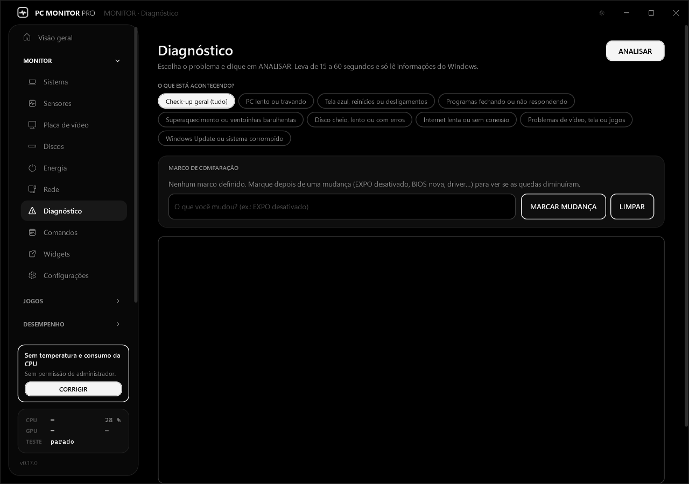
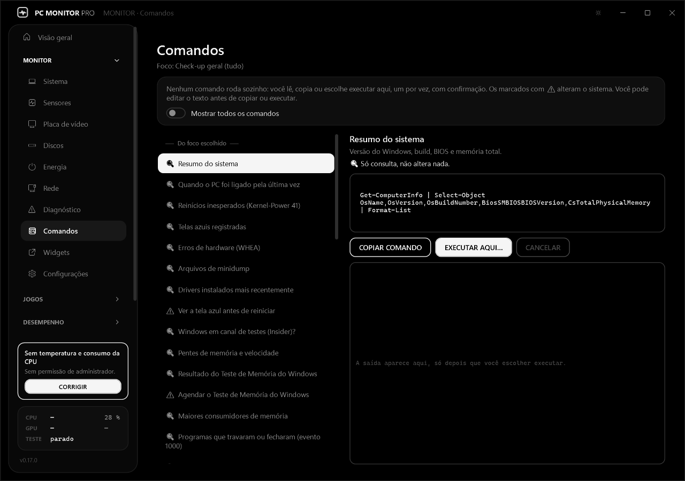
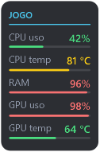
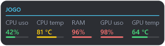
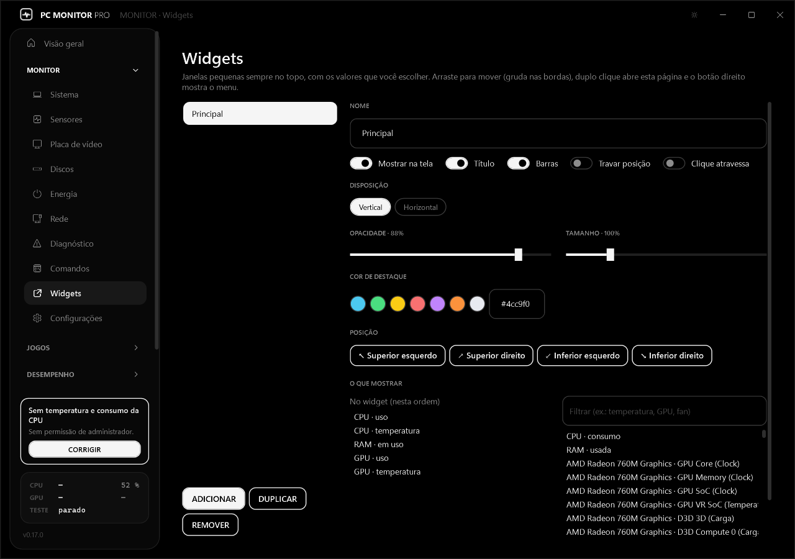

# Guia de uso

O PC Monitor Pro abre sempre como **administrador** (o Windows pede confirmação). Isso é necessário para ler as temperaturas
da CPU e da placa-mãe. Para temperatura e consumo da CPU, instale também o driver PawnIO uma vez: `winget install namazso.PawnIO`.

Tudo o que o programa guarda fica em `%AppData%\PCMonitorPro` (configurações, histórico e log). Nada é enviado para fora do PC,
exceto o que você pedir de forma explícita (baixar driver, instalar app pelo winget, consultar FPS de jogos se você informar uma chave).

## Diagnóstico

1. Escolha o que está acontecendo (tela azul, lentidão, calor, disco, rede, vídeo, Windows Update ou check-up geral).
2. Clique em **ANALISAR**. Leva de 15 a 60 segundos e só **lê** informações do Windows (eventos, discos, rede, desempenho).
   Dá para cancelar.
3. O relatório mostra a **causa mais provável**, as evidências e os próximos passos. Ele é salvo sozinho em
   `Documentos\PCMonitor` (a pasta pode ser trocada em Configurações) e nunca sobrescreve um relatório anterior.

**Marco de comparação:** depois de mudar algo (desativar o EXPO, atualizar a BIOS, trocar o driver), clique em *Marcar mudança*.
O diagnóstico passa a comparar as quedas **antes** e **depois** desse momento.

**Queda detectada:** o programa grava os sensores a cada 5 segundos. Se a sessão anterior terminou sem a marca de fim normal
(tela azul, queda de energia, reinício seco ou fechamento forçado), um aviso mostra o horário e os últimos valores gravados.

> O relatório é uma **hipótese**. Confirme antes de trocar peças.

## Comandos

Lista de comandos de PowerShell sugeridos, ordenada pelas causas mais prováveis do último diagnóstico. **Nada roda sozinho.**
Você lê, edita se quiser e escolhe **Copiar** ou **Executar aqui**, que sempre pede confirmação. Os marcados com ⚠ alteram o
sistema. A saída aparece na própria página e dá para cancelar.

## Widgets

 

Janelas pequenas, sempre no topo, que não tiram o foco do jogo.

- **Mover:** arraste. Ele gruda nas bordas da tela (a menos de 14 px). Ou escolha um dos quatro cantos na página.
- **Duplo clique** no widget abre a página Widgets; o **botão direito** abre o menu (configurações, travar posição, ocultar).
- **Aparência:** vertical ou horizontal, barras, título, cor de destaque, opacidade e tamanho.
- **Clique atravessa:** o widget deixa de receber o mouse (o clique vai para o que está atrás). Para voltar, desmarque a opção na
  página Widgets.
- **O que mostrar:** uso e temperatura da CPU e da GPU, RAM, consumo da CPU ou **qualquer sensor** do LibreHardwareMonitor,
  com filtro e ordem editável. Pode criar vários widgets.
- Cores: o valor fica amarelo e depois vermelho em temperatura e uso (limites em Configurações).

Limitação: sobre jogos em **tela cheia exclusiva** os widgets podem não aparecer (é uma limitação do Windows para janelas comuns); prefira janela sem borda.

## Configurações

- **Alertas de temperatura e RAM:** aviso no canto da tela quando passar do limite (padrão 90 °C e 95%). O mesmo sensor só
  avisa de novo depois de 5 minutos. Leituras acima de 125 °C são descartadas como erro de sensor.
- **Iniciar com o Windows:** cria uma tarefa do Agendador que abre o programa, já como administrador, ao entrar no Windows.
  Por segurança, **só ativa** se o `.exe` e a pasta dele não puderem ser alterados por programas comuns (por exemplo, instalado
  em `C:\Program Files`). Sem essa regra, qualquer programa poderia trocar o arquivo e virar administrador.
  **Como liberar:** use o instalador (`PCMonitorPro-Setup-<versão>.exe`): ele instala em `C:\Program Files\PC Monitor Pro` e já
  oferece essa opção na instalação. Se você instalou por ali, a opção desta página funciona normalmente.
- **Bandeja do sistema:** o ícone fica ao lado do relógio (duplo clique abre, botão direito tem *Abrir* e *Sair*). Com a opção
  *Ao fechar a janela, continuar na bandeja* ligada, fechar a janela só a esconde: widgets, histórico e alertas continuam. Com
  *Iniciar com o Windows* ligado, o programa abre direto na bandeja. Abrir o programa de novo traz a janela de volta.
- **Perfil (exportar / importar):** salva em um arquivo `.pmpperfil` as suas configurações e os resultados de benchmark, para
  levar a outro computador ou guardar numa nuvem (Google Drive, OneDrive, pen drive). Você escolhe o que entra: aparência,
  widgets, alertas, histórico, overlay, foco do diagnóstico, bandeja e benchmarks. Na importação, o que você marcar
  **substitui** o atual, exceto os benchmarks, que são **somados** (sem repetir). O nome do computador no arquivo é opcional.
  **Nunca vão no arquivo:** chave da API, backups do Windows (restaurar originais), perfis e programas dos jogos (caminhos e
  comandos) e a pasta dos relatórios. Um perfil de fora é tratado como não confiável: tamanho limitado e valores validados.
- **Sincronizar com o Google (opcional):** envia o perfil de cada computador para uma pasta oculta do aplicativo no seu Google
  Drive e deixa baixar o de outro PC. Exige uma configuração única no Google Cloud; veja o [passo a passo](GOOGLE.md).
- **Histórico de sensores:** liga/desliga a gravação e define por quantos dias guardar (padrão 14). Vale na próxima abertura.
- **Cores dos widgets:** limites de amarelo e vermelho para temperatura e porcentagem.
- **Relatórios:** pasta onde o diagnóstico é salvo.

## Perguntas frequentes

**O Windows ou o antivírus avisou sobre o programa.** O programa não é assinado digitalmente e pede administrador, então o
SmartScreen e alguns antivírus desconfiam. Baixe só das *Releases* do repositório e confira o `SHA256SUMS.txt`.

**As temperaturas da CPU não aparecem.** Abra como administrador e instale o PawnIO (`winget install namazso.PawnIO`).

**"Iniciar com o Windows" foi recusado.** A pasta do programa é gravável por usuário comum. Instale em `C:\Program Files`
(ou outra pasta só de administrador) e ative de lá.

**O aviso de "sessão anterior terminou de forma inesperada" apareceu, mas o PC não caiu.** Ele também dispara se o programa foi
fechado à força, pelo Gerenciador de Tarefas.
